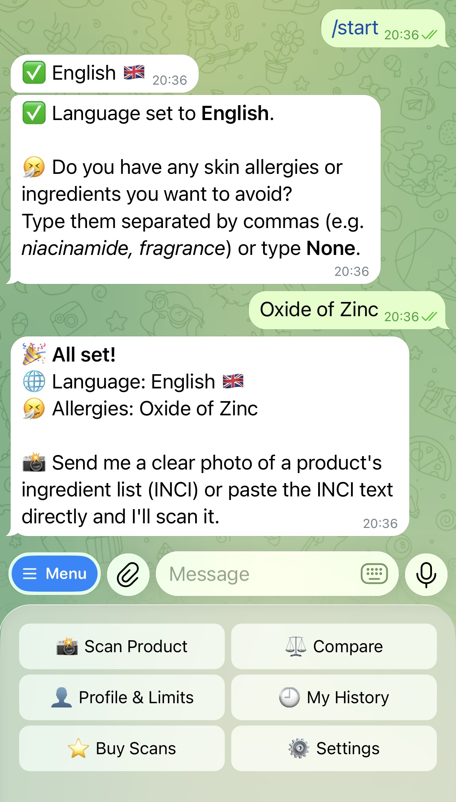
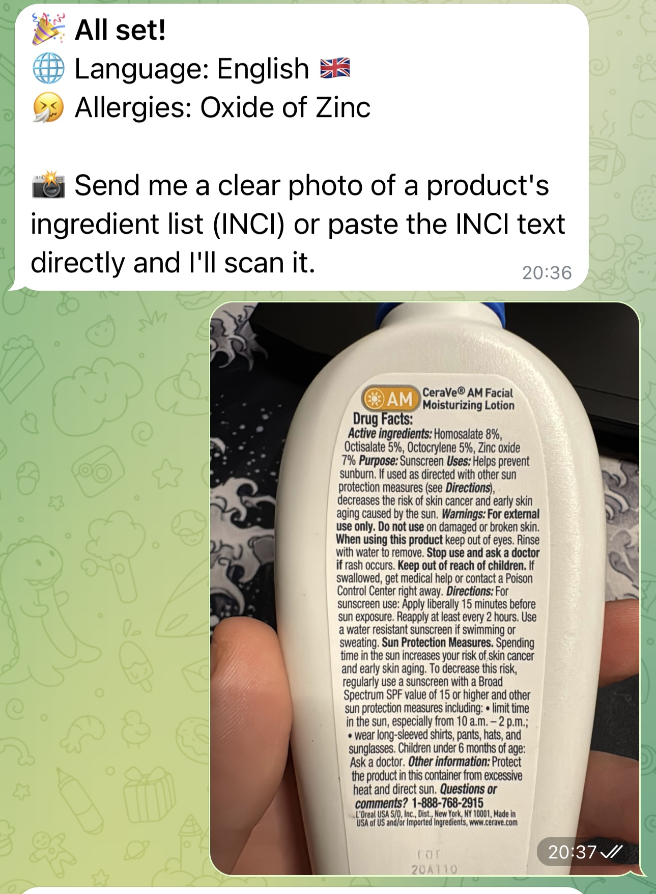
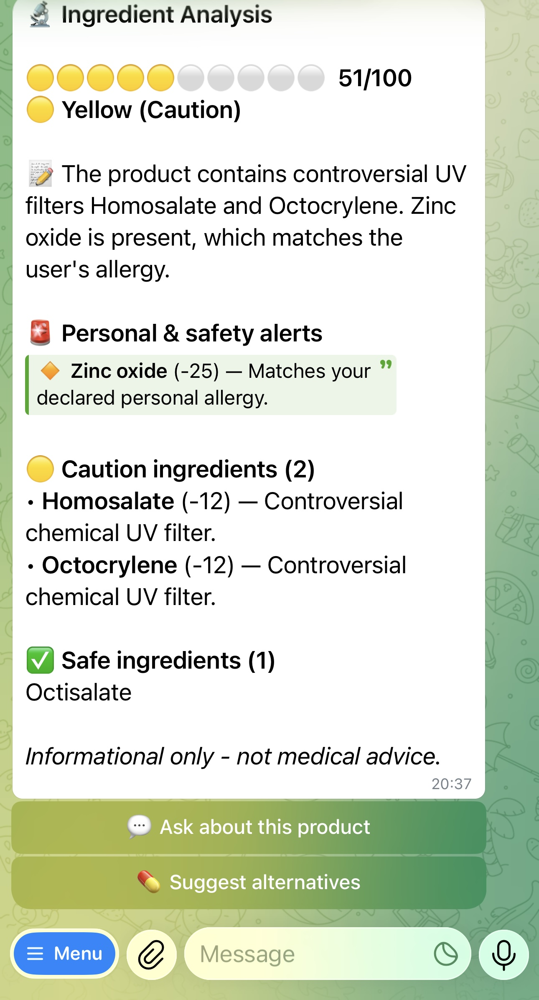
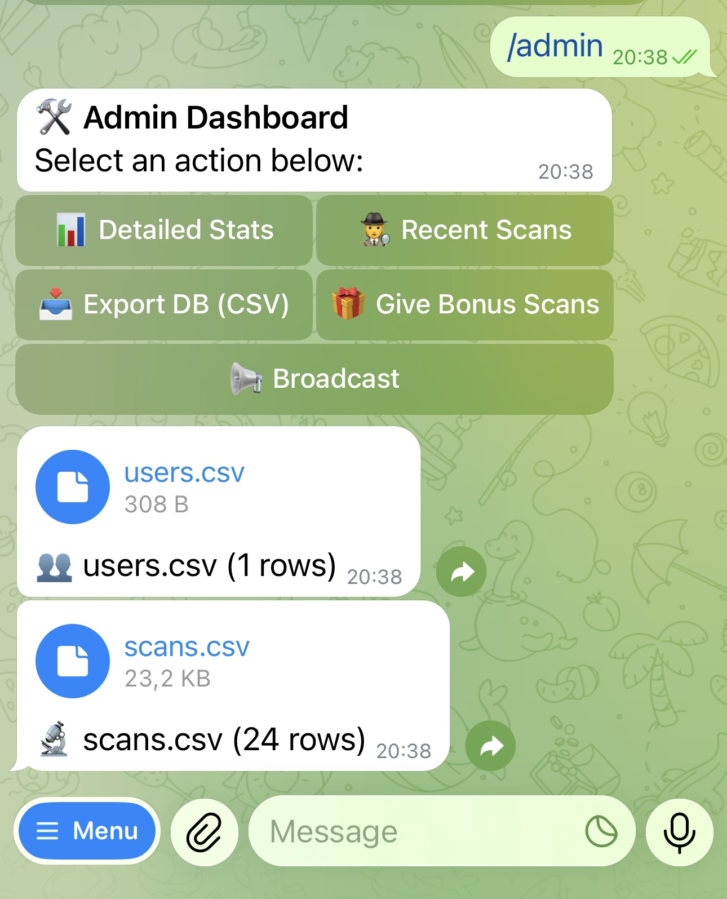

# 🔬 Cosmetic & Pharmacy Ingredient Scanner Bot (INCI)

An asynchronous, multilingual Telegram bot (`aiogram 3.x`, `aiosqlite`, `OpenAI GPT-4o / GPT-4o-mini`) built for the **Romanian & EU cosmetics and pharmacy market**. Consumers can photograph any product's ingredient label—or paste raw INCI text from online stores like *Farmacia Tei, Dr. Max, Notino, or eMAG*—to receive a deterministic **Traffic-Light Safety Report** (`0–100`), personalized allergen & safety-mode alerts, side-by-side product comparisons, and real Romanian pharmacy alternatives.

---

## 🎯 Problem Solved

Reading cosmetic and pharmacy ingredient labels (INCI) is difficult for everyday consumers, while naive "wrap an LLM prompt" scanners suffer from two major flaws:
1. **Score drift & hallucinations:** An uncalibrated LLM will score the exact same sunscreen `65/100 Yellow` on one run and `85/100 Green` on the next, or guess ingredients from a brand name when the back label isn't even visible.
2. **Poor localization & generic advice:** Expats and locals in Romania need native support across **Romanian 🇷🇴, English 🇬🇧, Russian 🇷🇺, and Ukrainian 🇺🇦**, plus recommendations for real products actually stocked in local pharmacies rather than generic placeholders.

This project solves both problems by separating **LLM extraction/classification** (`temperature=0`, `seed=7`, strict anti-hallucination guardrails) from a **deterministic Python scoring engine and regex rule table**.

---

## ✨ Key Engineering Highlights

- **Deterministic Python Scoring Engine (`analyzer.py`):**
  - OpenAI Vision (`gpt-4o`) and Text (`gpt-4o-mini`) calls run at `temperature=0`, `seed=7` and only transcribe and classify visible ingredients—they never invent the final score or guess product names.
  - A compiled regex rule table pins EU-restricted substances, formaldehyde releasers, chemical UV filters (`Homosalate`, `Octocrylene`, `Oxybenzone`), `BHT`/`BHA`, aluminum salts, sulfates, drying alcohols, PEGs, parabens, microplastics, and petrochemicals to fixed point deductions.
  - Calibrated rubric: a safe-ingredient list (Phenoxyethanol, Glycerin, Citric Acid, EDTA, …) can never be penalised; controversial ingredients (BHT/BHA, triclosan, MIT/CMIT, formaldehyde releasers, oxybenzone, butyl/propylparaben) are forced **Red**; mild items are capped (SLES `-5`, Benzyl Alcohol `-3`, PEG `-5` each). Group caps (**`-10` max** for `Parfum` + fragrance allergens, **`-10` max** for PEGs), a **`45` sanity floor** (lifted at 5+ Yellow ingredients) and a "any Red keeps it out of Green" ceiling keep scores fair. Thresholds: **75–100 Green, 50–74 Yellow, 0–49 Red**.
- **Personalized Safety Modes & Allergy Matching:**
  - Per-user toggles for **🤰 Pregnancy / Breastfeeding Safe** (flags retinoids—while excluding *Bakuchiol*—salicylic acid, hydroquinone, oxybenzone, and formaldehyde releasers as **Red `-25`**, bypassing the Yellow floor), **🫧 Acne-Prone (Comedogenic Check)**, and **🌿 Sulfate & Silicone Free**, alongside custom free-text allergy matching.
- **Multilingual Async Architecture (`aiogram 3.x`):**
  - Strict 4-language parity (`en`, `ro`, `ru`, `uk`) in `texts.py` with zero hardcoded UI strings in handlers.
  - Custom `UserTrackingMiddleware` keeps `@username`, `first_name`, and daily active user metrics fresh in SQLite on every interaction without overwriting user preferences or scan quotas.
  - Safe HTML report cards (`ParseMode.HTML`) with automatic `html.escape`, tag-safe 4096-character truncation, delete-and-send message lifecycle, and automatic plain-text fallback.
- **Online Shopping Text Scanner, 2-Product Comparison & Opt-In Follow-Ups:**
  - Paste raw INCI lists directly into the chat (with automatic garbage-text detection and scan refund).
  - Side-by-side **⚖️ Compare 2 Products** picker (`cmp_pick1` → `cmp_pick2`) and opt-in **💬 Ask about this product** (FSM Q&A) and **💊 Suggest alternatives** (real brands from *Farmacia Tei, Dr. Max, Bebe Tei, Help Net, dm*), powered by `gpt-4o-mini` without consuming scan credits.
- **Growth & Native Telegram Stars (`XTR`) Monetization:**
  - Atomic scan consumption priority (`daily_scans` auto-resetting at midnight → non-expiring `bonus_scans` → limit CTA) with source-accurate refunds on error.
  - Deep-link referral system (`/start ref_<user_id>`) with self-referral and existing-user guards, awarding **`+5` bonus scans** to both referee and referrer only after the referee completes their first real scan.
  - Native **Telegram Stars (`XTR`)** payments (`/buy`, `provider_token=""`) with `UNIQUE` `telegram_payment_charge_id` idempotency in SQLite to prevent double-crediting.
- **Zero-Downtime `aiosqlite` Migrations & Interactive `/admin` Panel:**
  - `DatabaseManager.init_db()` inspects `PRAGMA table_info(...)` on startup and executes safe `ALTER TABLE ... ADD COLUMN` migrations in place.
  - Role-guarded `/admin` dashboard featuring **📊 Detailed Stats**, **🕵️ Recent Scans**, **📥 Export DB (CSV)** (`users.csv` and `scans.csv` encoded in-memory with `utf-8-sig` BOM for clean Excel rendering of Romanian/Cyrillic text), **🎁 Give Bonus Scans** (by `user_id` or `@username`), and rate-limited **📢 Broadcast** with `TelegramForbiddenError` handling.
- **Anonymous Support Relay & Cloud-Ready Deployment:**
  - `/support` (and an inline `🆘` button in `/settings` & `/profile`) relays text or screenshots to the admin with an `↩️ Reply to user` button, keeping the admin's identity hidden from users; blocked users never crash the reply flow.
  - `DB_PATH` / `TZ` environment variables and a `Procfile` (`worker: python bot.py`) make the bot deployable on any worker-style PaaS with a persistent volume.
- **90-Assertion Automated Test Suite (`test_upgrade.py`):**
  - End-to-end tests driving the real `aiogram.Dispatcher` and `aiosqlite` database with mocked OpenAI and Telegram sessions at zero API cost.

---

## 🗂️ Project Architecture

```text
scanner_project/
├── bot.py             # aiogram 3.x router, middleware, FSM flows, payments & /admin dashboard
├── analyzer.py        # OpenAI Vision/Text prompts, deterministic rubric, regex rules & follow-ups
├── database.py        # Async SQLite manager, in-place schema migrations, quotas, referrals & exports
├── texts.py           # Strict 4-language localization dictionary (English, Romanian, Russian, Ukrainian)
├── test_upgrade.py    # 90-assertion automated end-to-end test suite (offline, zero token cost)
├── assets/            # Telegram UI screenshots for portfolio showcase
├── Procfile           # Cloud worker definition (`worker: python bot.py`)
├── requirements.txt   # Production Python dependencies
├── .env.example       # Template for required environment variables
└── .gitignore         # Excludes secrets (.env), virtualenvs, and local SQLite databases (*.db)
```

---

## 📸 Screenshots

| 🌍 1. Multilingual Onboarding | 📸 2. Photo & INCI Submission | 🔬 3. Traffic-Light Safety Report | 🛠️ 4. Admin Dashboard & Stats |
| :---: | :---: | :---: | :---: |
|  |  |  |  |
| _4-language selection (`RO`, `EN`, `RU`, `UK`), personal allergy setup & persistent menu_ | _Instant in-memory photo capture or pasted INCI text from online pharmacies_ | _Deterministic `0–100` score bar, flagged risks, safe ingredients & opt-in Q&A / alternatives_ | _Live user/scan metrics, language breakdown, Stars revenue, CSV export & broadcasts_ |

---

## 🚀 Quick Local Setup

### 1. Clone & Create a Virtual Environment

```bash
git clone https://github.com/<your-username>/ingredient-scanner-bot.git
cd ingredient-scanner-bot

python -m venv .venv
# Windows (PowerShell):
.\.venv\Scripts\Activate.ps1
# macOS / Linux:
source .venv/bin/activate

pip install -r requirements.txt
```

### 2. Configure Environment Variables

Copy `.env.example` to `.env` and fill in your credentials:

```bash
cp .env.example .env
```

```ini
BOT_TOKEN=your_telegram_bot_token
OPENAI_API_KEY=your_openai_api_key
ADMIN_ID=123456789
```

### 3. Run the Bot

```bash
python bot.py
```

The SQLite database (`ingredients.db`) and all tables/migrations are initialized automatically on startup.

---

## 🧪 Running the Automated Test Suite

The test suite runs against an isolated temporary SQLite database and mocks all external network calls:

```bash
python test_upgrade.py
```

Expected output: **90 `PASS` assertions and `FAILED: 0`**.
